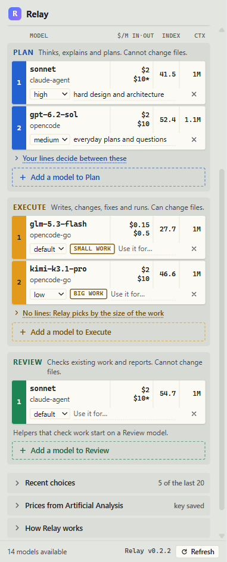
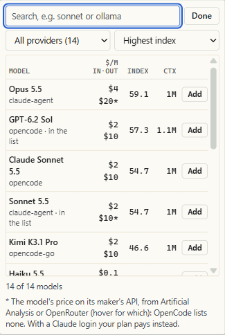
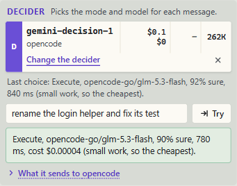
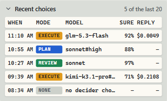

# Relay guide

What the [README](../README.md) leaves out: installing from source, each setting in the panel, how Relay behaves in a chat, and what to do when the panel is missing.

## Install from source

The [README](../README.md#install) installs Relay from npm by name, which is the simplest way. To run the code in this repository instead, you need OpenCode 2.3 or newer, and Node.js 24 with npm and git.

1. Get Relay and build it:

   ```sh
   git clone https://github.com/AsadKhalil/relay-opencode.git
   cd relay-opencode
   npm ci
   npm run build
   ```

2. Tell OpenCode to load it. Open OpenCode's global config file, `~/.config/opencode/opencode.json` (on Windows, `C:\Users\<you>\.config\opencode\opencode.json`; create it with `{}` if it does not exist), and add the folder you cloned to `plugins`:

   ```json
   {
     "plugins": ["/full/path/to/relay-opencode"]
   }
   ```

   On Windows, write the path with forward slashes, for example `"C:/Users/you/code/relay-opencode"`. Keep any plugins that are already in the list.

3. Quit OpenCode completely and open it again.
4. Check: type `/` in a chat. `/relay` should be in the list.

OpenCode watches the files it loads, so a new build in this folder reloads Relay in a running OpenCode. If you work on Relay itself, use a fixed copy instead.

### Install a fixed copy

A fixed copy is a packed build installed into a folder of its own. Building or changing the repository then does not touch the OpenCode you use every day. This is how the author's own OpenCode loads Relay.

1. In the repository, after `npm ci` and `npm run build`, pack the build: `npm pack`. It writes `relay-opencode-<version>.tgz`.
2. Make a folder for the copy, for example `~/.config/opencode/relay`, and install the file there:

   ```sh
   mkdir -p ~/.config/opencode/relay
   cp relay-opencode-<version>.tgz ~/.config/opencode/relay/
   cd ~/.config/opencode/relay
   npm init -y
   npm install --no-audit --no-fund ./relay-opencode-<version>.tgz
   ```

3. In `plugins`, name the installed package folder: `"<home>/.config/opencode/relay/node_modules/relay-opencode"` (on Windows with forward slashes, for example `"C:/Users/you/.config/opencode/relay/node_modules/relay-opencode"`).
4. Quit OpenCode completely and open it again.

## Update

- **Installed by name from npm:** `opencode plugin remove relay-opencode@<old version>`, then `opencode plugin add relay-opencode@<new version>` (`npm view relay-opencode version` prints the newest), then quit and reopen OpenCode. `plugin add` on its own adds a second entry. By hand, set the new version in the `plugins` entry instead. An unpinned `"relay-opencode"` can stay on an older copy that OpenCode keeps in `~/.cache/opencode/npm/`.
- **From source:** `git pull`, `npm ci`, `npm run build`, then restart OpenCode.
- **A fixed copy:** quit OpenCode, then in the repository `git pull`, `npm ci`, `npm run build` and `npm pack`, and in the copy's folder `npm install --no-audit --no-fund ./relay-opencode-<version>.tgz` with the new file. Open OpenCode again. Quitting first keeps OpenCode from reloading the plugin while its files change.

Relay keeps its settings, switches and records in OpenCode's own storage under the id `relay-opencode`, so every way of updating keeps them.

## Set up

Open a chat, open the command palette (Ctrl+K) and run **Open Relay**. The Relay panel opens beside the chat. The settings are shared by all your projects. The terminal app has no settings screen, so set them up in Desktop.

The panel is laid out like a board of flight strips: the **Decider** at the top, then the **cost strip** (spent, tokens and replies over the last seven days; click it to open Relay usage), then a bay for each mode, **Plan**, **Execute** and **Review**, holding one strip for each model you chose. Below the bays sit four drawers: Recent choices, Prices from Artificial Analysis, How Relay works, and Review rules. The last row shows the number of models OpenCode offers, which Relay you run (such as "Relay v0.2.2") and **Refresh**. The panel follows Desktop's light or dark theme with its own colours.



### Models for each mode

Add models to **Plan**, **Execute** and **Review**: press **Add a model to …** at the end of a bay.



- A rack lists the models OpenCode offers you, with the price per million tokens (input over output), the intelligence index and the context size, in the same order as on the strips.
- Type in the search box to find one by its name or its provider, narrow the table to one provider, or sort it by price (cheapest first), by context (largest first) or by index (highest first). Press **Add** on a row.
- Each chosen model is a **strip**. The coloured block at its left is its slot: 1 is the first, used when no line fits. Then the model and its provider, and three printed fields: price per million tokens (input over output), index and context. Below them: its effort (low, high and so on, when the model offers them), a stamp when Relay chooses by itself ("big work", "small work" or "all work"), its "Use it for…" line, and × to remove it.
- A strip whose model OpenCode no longer offers sits pushed to the side with an **unavailable** stamp, and the bay says to remove it or reconnect its provider.
- The prices come from OpenCode's own model catalog, which OpenCode fills from [models.dev](https://models.dev). For a model OpenCode lists no price for (every model of the `claude-agent` provider, Claude through a subscription login), the table shows that model's price on its maker's API, marked `*`: Artificial Analysis's once you have saved a key ([below](#prices-from-artificial-analysis)), else OpenRouter's public one. Hover over it to see which. With a Claude login your plan pays instead. A model OpenCode offers free (an id ending `-free`, or Free in its name) reads "$0 (free)" and never borrows the paid model's price. The context size is OpenCode's, else OpenRouter's. "not listed" means neither has a price, and "$0 or not listed" means the catalog says 0, which can be either. **Cheapest first** sorts by the price shown.
- Hover over a strip's figures for the sentence behind them, for example "$2 in / $10 out per 1M tokens on the API (Artificial Analysis) · index 41.5 at high effort · 1M context". The index is the chosen effort's own when Artificial Analysis lists that effort, else the highest effort's, and the sentence says which. An estimated index prints in italics.
- The index is the Artificial Analysis Intelligence Index: from Artificial Analysis's own list once you have saved a key, and from OpenRouter's public model list, which carries the same index, where that list has none or there is no key. For a model with efforts, it is the score at its highest effort, and a lower effort scores less (GPT-6.2 Sol: 57 at max, 41 at low). The price per token is the same at every effort, but a higher effort writes more tokens, so each reply costs more. Hover over a number to see which list and which model it came from.
- A model neither list scores gets a **hint** instead, never a plain number, and Relay never ranks by it:
  - `<54.7`: likely below the score of a newer version of it (Claude Sonnet 5 is older than Sonnet 5.5); `>44.2` likely above an older one; `44.1–57.3` between the two.
  - `≈22.4–35.1`: half of the scored models at about its price score in that range.
  - `—`: why there is no hint (a free model, a decision model, no price, or too few models at its price). Hover over the cell, or read the line under a chosen model, for the sentence. See [data sources](data-sources.md).
- When a mode has more than one model, write a short "use it for" line for each, for example "hard design and architecture" or "small, quick edits". The decision model matches your message to these lines. It also reads the end of the chat's last reply, so a short follow-up such as "Implement it." is matched by the plan before it. It never sees model names or prices.
- When no line fits clearly, Relay uses the first model in the mode's list, so put your everyday model first. A move to a cheaper model is still made only when it pays (see [When Relay saves money](saving-money.md)).
- **Or write no lines at all, and Relay chooses by itself.** With two or more models in a mode and no line written, the decision model is asked only how big the work is: small and clear, or big, unclear or risky (a failed try in the last reply counts as big). Big work goes to the model with the highest index, small work to the cheapest.
  - "Index" is Artificial Analysis's Coding index for Execute when every model there has one (with your Artificial Analysis key), and the main index otherwise.
  - "Cheapest" is a typical request at the model's prices, counting how much that model itself writes once it has three replies Relay counted.
  - In Review, a reviewer with a lower index than the model that wrote the work is not used.
  - The decision model judges the size by your message, the end of the chat's last reply, and the chat's first message, which says what the task is. Work with many rules or edge cases to get right counts as big, even in one file.
  - When it is not sure how big the work is, the model with the highest index is used: unclear work counts as big. When it gives no size at all, or a model has no index or no price, the first model is used. The panel says why under the list.
  - The panel stamps each model's part on its strip: "big work", "small work" or "all work". It reads only what Relay has stored, so the index list must have been loaded once (the model tables load it).
  - Two rows of one model need an effort on each; "default effort" can't be ranked against the same model's named effort.

### The decider



- Press **Choose a decider** and **Use** on a row. The rack lists only the decision models OpenCode offers you; `opencode/jev-1.13-free` is free.
- The decider is a strip with the slot **D**. **Change the decider** opens the rack again, and × removes the decider. Until you choose one, the panel and the pill warn you: without a decider, Relay switches nothing.
- Under it: Relay's last choice, a box to type a sample message and **Try** what Relay would pick, and **What it sends to …**, which opens to list exactly what leaves your machine to make a choice.

### Relay usage

The **Relay usage** tab shows every reply of every chat: with Relay on or off, `/relay` messages, helpers, and OpenCode's summaries of long chats. Open it with **Open usage** in the Relay panel, or **Open Relay usage** in the command palette. It counts from the version that brought it on, and keeps each record for 90 days.

- **Range:** today, 7, 30 or 90 days, in your own time zone.
- **Spent, Tokens and Replies:** what the range cost where a price is known (it says how many replies have none), every token, and the replies and requests. In is what was read new, from a cache and into a cache; out includes reasoning.
- **Chart:** one bar a day, split by model (the five largest, the rest as "other"), for cost, tokens or requests, with the tallest bar's value at the top and the days beneath. Hover over a bar for that day's numbers.
- **By model:** one row a model, most spent first: its cost, provider, replies and tokens. Click a row to show only that model.
- **Search and filters:** search by model. Under **Filters**: provider, effort, mode (or the agent, for a chat Relay did not place), Relay on or off, chat, helper or summary, and project. A note at the top says when the numbers are filtered, with **Clear**.
- **Relay switching:** what Relay's moves did in the range, under **Compare with**:
  - **Default model** compares each chat with the model it was on before Relay first moved it. For a chat from before this version, that is the model of its last reply before Relay's first message. A chat with neither is not compared, and the plate says how many.
  - **Plan model** compares every chat with your Plan mode's first model, as it is set now. It is greyed out until you set one.
  - **Switches** counts the replies Relay moved to another model, and **Switches to each model** shows where they went.
  - **Spent** is what the range cost, plus what Relay's decisions cost. **Without switching** is the same replies at the other model's prices, from each chat's first move on. **Saved** is the difference, with its percent; when the moves cost more, it says "more".
  - The chart has one pair of bars a day: the outline is the cost without switching, and the filled bar inside it is what was spent.
  - A reply that has no price on one side is left out of the comparison, and counted.
- **Cost:** each kind of token times its price for a million tokens. Reasoning is priced as output. The prices are OpenCode's own when it lists them, which is what you pay. Otherwise, such as for Claude or Codex through a subscription login, they are public prices, marked `*`: Artificial Analysis's once you have saved a key (below), else OpenRouter's, which needs no key. Otherwise the cost is OpenCode's own when it is more than $0. A model OpenCode offers free by its name costs $0. Go is billed by allowance, so its cost is the list price. Amounts under $0.10 show two significant digits, such as $0.069.
- **Before this history:** the totals Relay counted before this tab, of its own messages only (since 19 Nov).

In OpenCode's terminal app, `/relay-stats` shows those older totals in a dialog.

### Prices from Artificial Analysis

OpenCode lists no price for some models, such as Claude through a subscription login. For those, Relay can take each model's prices (in, out, cache read and cache write) and its intelligence index from Artificial Analysis, with a free key from [artificialanalysis.ai](https://artificialanalysis.ai/). Paste the key under **Prices from Artificial Analysis** in the panel and press Save; Remove deletes it.

- Relay downloads Artificial Analysis's free model list at most once a day. That is four of the 100 requests a day the free key allows.
- With a key saved, the model tables show Artificial Analysis's own index, and OpenRouter's copy of it for a model Artificial Analysis's free list has no index for.
- A model is matched by its exact name, so one listed under another name gets no price (on 26 Nov 2026 Claude Haiku 4.5 through a Claude login, which Artificial Analysis lists as `claude-4-5-haiku`).
- Artificial Analysis lists one price for each model, so a higher price for long chats is not there.
- Its data is credited wherever Relay shows it.

### Recent choices



**Recent choices**, the first drawer below the bays, lists the last 20 decisions, for chats and helpers, and updates by itself. Each is one line: when (the time today, the date before), the mode, the model, how sure the decider was, and what the reply cost. Hover over a line for the whole record, which also says what the reply took:

- **The reply:** the model and effort that answered, how many requests the reply made, and all of them added up: tokens in, out, reasoning (when there is any), read from a cache and written to a cache, with the cost OpenCode worked out (when the model has a listed price).
- **Prices:** that model's listed prices for a million tokens: in, out, cache read and cache write, at the size of the reply's first request. "$0 or not listed" means OpenCode has no price for it, as for Claude through a subscription login.
- **First request:** the tokens it read new (in, and written to a cache), the tokens it read from a cache, its cost, and the seconds until the first word. A switch to another model shows up there as a large "read new" number.

A row kept before 19 Nov 2026 has no model, totals or prices, only the number of requests and the first request.

The screenshots show the panel with sample settings and sample rows, from the preview (`npm run preview:panel`) on 26 Nov 2026. The models, prices and index numbers are shaped like what OpenCode and the public lists showed that day.

## Use

| You type | What happens |
|---|---|
| `/relay <message>` | Relay picks the mode and the model for this one message, switches the chat, and sends it. |
| `/relay on` | Every message you send in this chat goes through Relay, without typing `/relay`. |
| `/relay off` | This chat goes back to normal. |
| `/relay-stats` | In the terminal app: shows the totals of the messages Relay placed (since 19 Nov) in a dialog. |

- In Desktop, the **Relay pill** above the chat box shows whether Relay is on for that chat. Click it to turn Relay on or off there, and to see the last choice. With no decider chosen it reads **Relay on · no decider**, and its menu opens the Relay panel.
- OpenCode shows a "Switched to …" line in the chat when Relay changes the model, and Desktop's model picker follows Relay's choice.
- Plan and Review use OpenCode's `plan` agent, which is meant for reading and planning, not editing. Only Execute uses `build`, which can change files.
- When the decision model is not sure (under 60%), `/relay` uses Plan. With `/relay on`, the chat stays as it is.
- In a long chat, a move to a cheaper model of the same mode is made only when it pays, and a model the chat no longer fits is not used. See [When Relay saves money](saving-money.md).
- When a model starts a helper (an OpenCode subagent) to check work, Relay gives that helper your Review model, even if the model that starts it asked for another one, and rules that make a review end: a verdict every time, and at most three checks.
- In the terminal app, `/relay`, `/relay on` and `/relay off` work the same way. There is no pill there, and `/relay on` prints nothing.

## If Open Relay is missing

It shows only while a chat is open. Then check Settings → Extensions → Plugins: `relay-opencode` should be listed with **Reload** and a switch. If that list stays empty, or Desktop says it can't reach your computer, OpenCode's background service is not running properly and Desktop shows no plugin panels. Quit Desktop, end `opencode-cli.exe` (the one started with `serve --service`) in Task Manager, and start Desktop again.
